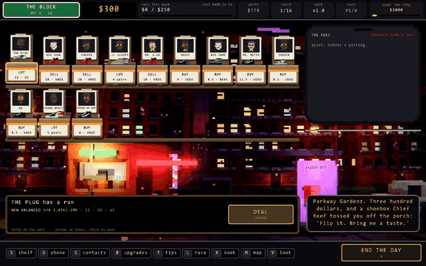

# rust-steam-starter

**From `cargo new` to a build on Steam: the integration, upload scripts, store-page assets and launch checklist from a shipped Rust game.**

[](https://github.com/Mattbusel/rust-steam-starter/actions/workflows/build.yml)


## Built from the pipeline behind O'BLOCK

[](https://store.steampowered.com/app/5357680/?utm_source=github&utm_medium=readme&utm_campaign=rust-steam-starter)

[**O'BLOCK**](https://store.steampowered.com/app/5357680/?utm_source=github&utm_medium=readme&utm_campaign=rust-steam-starter) is a free sneaker-flipping game written in Rust, released on Steam on October 20, 2026, with a paid DLC. This repo is lifted from how it ships: the `steam` cargo feature, achievements, rich presence, the depot layout including a DLC depot, the store art and achievement icon generators, and the mistakes that cost review rounds. Two parts are additions for you: O'BLOCK is Windows-only and its builds went up through the Steamworks web uploader, so the Linux depot, the SteamCMD script and the GitHub Actions upload are the scripted versions of the same layout. If you want to see the result running, it is free: [get it on Steam](https://store.steampowered.com/app/5357680/?utm_source=github&utm_medium=readme&utm_campaign=rust-steam-starter).

## What you get

| Path | What it does |
|---|---|
| `src/main.rs` | A tiny game (move, collect 10 coins) on [macroquad](https://github.com/not-fl3/macroquad). Swap it for your engine; only this file touches the window. |
| `src/steam.rs` | The Steam layer behind a `steam` cargo feature: init, relaunch through Steam, achievements, stats, rich presence, overlay pause, callbacks every frame. Without the feature it compiles to no-ops. |
| `steam/*.vdf` | SteamPipe build scripts with placeholders: app build, Windows depot, Linux depot, DLC depot, rich presence strings. |
| `steam/upload.py` | Fills the placeholders from env vars and uploads with SteamCMD. |
| `tools/make_capsules.py` | Every store and library image Steam asks for, from one key art image. |
| `tools/make_ach_icons.py` | 256x256 earned + locked achievement icons from a JSON list. |
| `tools/make_chunks.py` | Splits a build into zips under the web uploader's 2048 MB limit, for when you cannot use SteamCMD. |
| `.github/workflows/build.yml` | CI: Windows + Linux release builds with the Steam library packaged next to the binary. |
| `.github/workflows/release-to-steam.yml` | Manual workflow: build both, upload to a Steam beta branch. |

Click **Use this template** at the top of this page to start your own repo from it.

## Quick start

You need Rust (stable) and, for the Steam build, the Steam client running and signed in. On Linux also: `sudo apt install libx11-dev libxi-dev libgl1-mesa-dev`.

```sh
# Plain build: no Steam code, no DLL. This is what you ship to itch.io.
cargo run

# Steam build, using Spacewar (App ID 480), Valve's public test app.
cargo run --features steam
```

With `--features steam` the bottom line of the window says `Steam: signed in as <you>`. Collect 10 coins and Steam pops the **ACH_WIN_ONE_GAME** achievement on your account under Spacewar (it shows on your Spacewar achievements; that is expected). Open the overlay with Shift+Tab and the game pauses. If Steam is not running, the Steam build still starts and says why Steam is off.

No Steamworks account is needed for any of that. 480 exists for exactly this, and every Steam user can use it.

## The feature flag

```toml
[dependencies]
steamworks = { version = "0.13", optional = true }

[features]
steam = ["dep:steamworks"]
```

`src/steam.rs` defines one `Steam` type twice: the real one under `#[cfg(feature = "steam")]` and an empty one otherwise, with the same methods. Game code calls `steam.unlock("ACH_...")` and never needs a `cfg` of its own. O'BLOCK uses this to ship the same source to Steam and to itch.io, where the build has no `steam_api64.dll` at all.

The order in `main` matters:

1. **`restart_app_if_necessary` first.** If a player double-clicks the exe, Steam relaunches it through the client and this copy exits. It is skipped for App ID 480, because otherwise a stray launch opens Spacewar itself, and it always says "no restart" while `steam_appid.txt` is next to the exe or in the working folder (which is how `cargo run` works here).
2. **Init Steam before the window.** The overlay hooks the graphics API when Steam starts; a window created earlier can end up without it. That is why `main` is a plain `fn main` that calls `Window::from_config` after Steam, not `#[macroquad::main]`.
3. **`tick()` every frame.** Callbacks (overlay open, stats stored, call results) only arrive from `run_callbacks`.
4. **Never start a Steam call from inside a Steam callback.** steamworks 0.13 holds its call-result lock while a call-result callback runs. A leaderboard upload started inside the "found the leaderboard" callback deadlocked O'BLOCK on most saves (build 12, fixed in build 13). `Steam::defer` queues the next call and `tick` runs it after the callbacks.

### Using your own App ID

1. Pay the Steam Direct fee and create the app in Steamworks.
2. Put the App ID in `APP_ID` in `src/steam.rs` and in `steam_appid.txt`.
3. Define your achievements and stats in Steamworks > Stats & Achievements, then **Publish**. Until you publish, players do not get them.
4. Upload `steam/richpresence.vdf` under Community > Rich Presence and publish it.
5. Change the constants (`ACH_FIRST_WIN`, `STAT_GAMES`, `RP_PLAYING`) to your API names.

Watch for one number trap: the URL of your store page admin (`/admin/game/edit/<number>`) uses a **store item id**, which is not your App ID (O'BLOCK's are two unrelated numbers). The App ID is the number in `store.steampowered.com/app/<id>/`.

## Build the Steam binaries

```sh
cargo build --release --features steam
```

The game needs the Steam library next to it: `steam_api64.dll` on Windows, `libsteam_api.so` on Linux. `steamworks-sys` copies it into `target/release/build/steamworks-sys-*/out/`. Copy the binary and that library into `dist/windows/` or `dist/linux/`. CI does this for you (see the `Package` step in `build.yml`) and publishes them as the `steam-windows` and `steam-linux` artifacts.

On Linux, `.cargo/config.toml` sets an `$ORIGIN` rpath so the binary finds `libsteam_api.so` in its own folder.

Do not ship `steam_appid.txt`. The depot scripts exclude it.

## Upload to Steam

### From your machine (SteamCMD)

1. Install [SteamCMD](https://developer.valvesoftware.com/wiki/SteamCMD).
2. In Steamworks > SteamPipe > Depots you will see a depot with ID App ID + 1. Use it for Windows. Add a second depot for Linux and set its OS to Linux, so Windows players never download it.
3. Create a beta branch (SteamPipe > Builds > Manage Betas), for example `beta`.
4. Create `steam/.env` (it is git-ignored):

   ```
   STEAM_USERNAME=your_build_account
   STEAM_APP_ID=1234560
   STEAM_DEPOT_WINDOWS=1234561
   STEAM_DEPOT_LINUX=1234562
   STEAM_BRANCH=beta
   ```

5. Run `python steam/upload.py`. The first login asks for your password and a Steam Guard confirmation; SteamCMD caches it after that. `--dry-run` prints the rendered `.vdf` files and the command without uploading.
6. In Steamworks > SteamPipe > Builds, set the build live on **default**. SteamCMD cannot do this step, and Steamworks asks for a confirmation in the Steam Mobile app.

### From the browser (web uploader)

SteamPipe > Builds also takes a zip. Each upload is capped at 2048 MB, so `python tools/make_chunks.py dist/windows` splits a big build. Upload the first zip normally and later ones with **Merge With Baseline**. O'BLOCK shipped several builds this way; read the trap in the checklist below before you do.

### From GitHub Actions

`release-to-steam.yml` is manual (Actions > release-to-steam > Run workflow). It runs the build workflow, downloads both artifacts, installs SteamCMD on Ubuntu, and runs `steam/upload.py` against the branch you type in.

Repository secrets (Settings > Secrets and variables > Actions):

| Secret | Value |
|---|---|
| `STEAM_USERNAME` | The account that uploads. Use a separate Steam account with only the "Edit App Metadata" and "Publish App Changes To Steam" permissions for this app, not your main account. |
| `STEAM_CONFIG_VDF` | `base64` of SteamCMD's `config/config.vdf` after a successful login (below). |
| `STEAM_APP_ID` | Your App ID. |
| `STEAM_DEPOT_WINDOWS` | Windows depot ID. |
| `STEAM_DEPOT_LINUX` | Linux depot ID (leave the secret unset to skip Linux). |

There is no password secret. CI logs in with the cached login in `config.vdf`, which is how SteamCMD avoids asking for Steam Guard on every run. To make one:

1. On a Linux machine (WSL or a container is fine, so it matches the CI runner), run `steamcmd +login your_build_account +quit`, type the password, and approve the login in the Steam Mobile app (or type the emailed code).
2. Find `config.vdf`: `find ~ -name config.vdf -path '*config*'` (usually `~/Steam/config/config.vdf` or `<steamcmd dir>/config/config.vdf`).
3. `base64 -w0 config.vdf` and paste the output into the `STEAM_CONFIG_VDF` secret.

The limits, plainly:

- **The first login always needs a human.** Steam Guard has to be approved on the phone (or with an email code) once. CI cannot do that part.
- **The cached login can stop working.** Steam can expire it or ask for Steam Guard again, for example after a password change or when it decides the login looks new. The job then fails at `+login` (it is set to fail instead of waiting for a password). Repeat the three steps above and update the secret.
- **`config.vdf` is a credential.** Anyone with it can upload builds as that account. Keep it in secrets only, use the limited build account, and never commit it (`.gitignore` blocks `config.vdf`). The workflow deletes it from the runner at the end.
- **CI cannot set the default branch live.** It uploads and sets a beta branch live. Promoting to default stays a click in Steamworks plus the Steam Mobile confirmation.

## Store art and achievement icons

```sh
pip install pillow
python tools/make_capsules.py keyart.png --logo logo.png        # or --title "MY GAME"
python tools/make_ach_icons.py steam/achievements.json --art keyart.png
```

Sizes Steamworks asks for (it rejects other sizes):

| Image | Size | Notes |
|---|---|---|
| Header capsule | 920x430 | top of the store page, search results |
| Small capsule | 462x174 | lists; the name has to read at a glance |
| Main capsule | 1232x706 | front page carousel |
| Vertical capsule | 748x896 | seasonal sale pages |
| Page background | 1438x810 | behind the store page, art only |
| Library capsule | 600x900 | the player's library grid |
| Library header | 920x430 | library, recent games |
| Library hero | 3840x1240 | top of the library page, **no text or logo** |
| Library logo | 1280x720 | transparent PNG, drawn over the hero |
| Community icon | 184x184 | |
| Client icon | 32x32 | plus a `.ico` for the shortcut |
| Event cover | 800x450 | announcements; required for a Major Update post |
| Event header | 1920x622 | announcements |
| Screenshots | 1920x1080 | upload at least 5 |
| Achievement icons | 256x256 | one earned, one locked, per achievement |

## Launch checklist

Each item below comes from O'BLOCK's own launch notes. Where a number appears, it is from those notes or from Valve's rules, not a guess.

### Before you submit

- [ ] **Create the depots you need**: Windows at App ID + 1, a Linux depot with its OS set, and a DLC depot under the base app if you have DLC.
- [ ] **Achievements, stats, rich presence, Steam Cloud: publish every one.** Each stays developer-only until you press Publish. O'BLOCK's first build **failed review** because Steam Cloud did not sync: the Auto-Cloud setup was right, but the reviewers most likely tested while Cloud was still developer-only. The fix also added the Remote Storage API as a second path.
- [ ] **Capsule text matches the product name exactly.** O'BLOCK's DLC store page failed review because its capsules said "SUPPORTER PACK" and the product is "Complete Supporter Pack".
- [ ] **No text on the library hero; no quotes, awards or prices on capsules.**
- [ ] **Only tick languages you actually ship in game.** Store-page translations are separate and cheap; a ticked language the game does not have is a bad-review magnet.
- [ ] **Answer the content survey honestly**, including the AI content disclosure if any of your code, text or art was AI-generated. O'BLOCK discloses AI-assisted code and text and the AI art in its supporter wallpapers.
- [ ] **A crash log and a no-console release exe.** O'BLOCK writes a crash log on panic; this template's release build already hides the console on Windows (`windows_subsystem`).
- [ ] **QA on a fresh save folder**, never your own save, and never put a save file in a depot.

### Review and release timing

- [ ] **Store page and build are reviewed separately.** O'BLOCK submitted both on Sep 29, 2026. The store page was approved and showing as Coming Soon by Oct 6. The build came back failed on Oct 7 (the Cloud issue above), was fixed and resubmitted the same day, and the game released on Oct 20.
- [ ] **Steam requires the Coming Soon page to be public for at least two weeks before release**, so get the store page through review early. Wishlists can only collect while it is public.
- [ ] **Plan the date around Steam events.** Steam Next Fest (Oct 19 to 26, 2026) overlapped O'BLOCK's Oct 20 launch: Next Fest is for demos, a released game cannot enter it, and it fills creators' and press inboxes. Pitch creators before a festival week, or launch outside one.
- [ ] **Plan wishlists and revenue with numbers, not hope.** Estimate how many wishlists you need for a launch, and what a price and review count earn: [Steam wishlist calculator](https://tensorust.com/tools/steam-wishlist-calculator/?utm_source=github&utm_medium=readme&utm_campaign=rust-steam-starter), [Steam revenue calculator](https://tensorust.com/tools/steam-revenue-calculator/?utm_source=github&utm_medium=readme&utm_campaign=rust-steam-starter).

### Shipping builds

- [ ] **Setting a build live on default needs Steamworks and your phone.** SteamCMD's `SetLive` cannot target default, and Steamworks asks for a Steam Mobile confirmation. After you confirm, the default branch can show a **new merged build ID**, not the one you uploaded: check the build row's text, not the number you expected.
- [ ] **Web uploader: "Merge With Baseline" merges onto the build live on DEFAULT, not your last upload.** For a multi-zip build, set each upload live (a private branch works) before merging the next, and check the file list and size before going live.
- [ ] **Big builds go through SteamCMD.** The web uploader caps each zip at 2048 MB. O'BLOCK's lossless build was 29.8 GB.
- [ ] **Offer big optional content on a public beta branch.** O'BLOCK's default branch ships compressed Ogg audio (3.8 GB) and a public `lossless` branch with no password ships the 29.8 GB original. Players pick it in Properties > Betas, it needs no DLC review, and one exe serves both by loading whichever files exist. Update the store's storage requirement when the size changes.
- [ ] **Keep the plain build DLL-free.** The `steam` feature keeps `steam_api64.dll` out of builds for other stores.

### After launch

- [ ] **Event posts need their art attached on the ARTWORK tab before Publish**, or Steam refuses; a Major Update post needs a cover image. Posting also needs a steamcommunity.com login, separate from Steamworks.
- [ ] **Update visibility rounds:** Steam gives 5. Each puts the game on the front page for owners and wishlisters for up to 30 days or 1M impressions. A round cannot start until launch visibility ends, the linked announcement must be under 30 days old, and rounds do not show during major seasonal sales.
- [ ] **Steam's refund window is 14 days and under 2 hours played**, so the first two hours decide whether a paid game keeps the sale. Fix first-session crashes and confusion before anything else.

## Engine note

The skeleton uses macroquad because it builds fast and pulls few crates. O'BLOCK itself runs on [Proof Engine](https://github.com/Mattbusel/proof-engine), a from-scratch Rust engine; the Steam layer does not care which engine draws the frame.

## License

Dual-licensed under [MIT](LICENSE-MIT) or [Apache-2.0](LICENSE-APACHE), at your option. The O'BLOCK GIF in `assets/` is O'BLOCK game footage, included to show the game; it is not part of the template and is not covered by those licenses.
